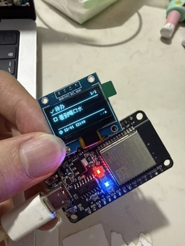

# ESP32 LED 控制器

通过浏览器，经 USB 串口、Wi-Fi 局域网或独立服务器控制 ESP32 的 LED，支持常亮、熄灭、闪烁、真正的 PWM 呼吸灯和标准 SOS，可收藏灯效、读取设备状态；可外接 OLED 显示时间、当地三天天气、待办和定时提醒。首次 Wi-Fi 配网使用 USB；联网后手机可直接访问板子，也可访问服务器工作台。网页无前端依赖；USB / 板子直连不需要 Node.js，独立服务器推荐 Node.js 22 LTS。

## 硬件和环境

- ESP32 DevKit / ESP32-WROOM，默认 GPIO 2、高电平点亮。
- 支持数据传输的 USB 线。
- Python 3.10 或更新版本（本项目使用 Python 3.12 验证）、Make。
- 桌面版 Chrome 或 Edge；Safari / Firefox 不支持 Web Serial。

部分开发板没有可控制的板载 LED，或引脚、有效电平不同。请以开发板原理图为准，修改固件中的 `LED_PIN` / `LED_ACTIVE_LOW`。外接普通 LED 时应串联限流电阻；本固件不适用于 WS2812 等可寻址 RGB 灯。

## 快速开始

在项目目录执行：

```sh
make setup
make build
make ports
make upload
make serve
```

首次构建会下载 ESP32 平台、Arduino 框架和编译工具链，需要联网。PlatformIO 安装到项目 `.venv`，构建产物位于 `.pio`。

用 Chrome / Edge 打开 <http://localhost:8000/esp32_led_control.html>，点击「连接串口」并选择 ESP32。首次连接和重连会先读取设备当前设定，随后即可切换模式、调整灯效参数与亮度。页面使用 ES modules，请通过 `make serve` 访问，直接双击 HTML 文件无法加载模块。

`make serve` 只启动网页服务器，不会烧录板子。首次使用或升级灯效 / 协议后需执行 `make upload`。如果设备回复 `ERR unknown command: STATUS`，说明板子仍是旧版固件，需要先烧录 v2 固件再连接。

如果系统默认 Python 版本不适合，可在首次安装时指定：

```sh
make setup PYTHON=python3.12
```

连接多个串口设备时，指定端口烧录：

```sh
make upload PORT=/dev/cu.usbserial-XXXX
make monitor PORT=/dev/cu.usbserial-XXXX
```

端口名称以 `make ports` 输出为准；Windows 示例为 `PORT=COM3`。串口波特率为 **115200**。串口监视器与浏览器不能同时占用同一端口，连接网页前退出监视器（Ctrl+C）。`make serve HTTP_PORT=8080` 可更换网页端口，Ctrl+C 停止服务器。

如果烧录一直停留在连接阶段，可尝试按住开发板 BOOT 键开始上传，建立连接后松开；部分 USB 芯片需要安装对应厂商的驱动。

## Arduino IDE

也可以在 Arduino IDE 中安装 Espressif 的 ESP32 板卡支持包，打开 `esp32_led_control/esp32_led_control.ino`，选择 **ESP32 Dev Module** 和设备端口后上传。在 Arduino IDE 的库管理器安装 **U8g2 2.36.5** 和 **ArduinoJson 6.21.5**。PlatformIO 固定使用 `espressif32@6.12.0` 及其 Arduino 框架。

仓库中的 `esp32_led_control/web_assets.h` 包含已生成的网页资源，Arduino IDE 可直接编译，无需 PlatformIO 的包含路径。修改 HTML、CSS 或 `web/*.mjs` 后，先在项目目录执行 `make web-assets`（或 `python3 scripts/embed_web.py`），再用 Arduino IDE 上传；PlatformIO 构建会自动更新此文件。当前固件使用 ESP32 Arduino 2.0.17 验证。

## 第一阶段功能

- **呼吸灯**：PWM 按余弦曲线从 0 平滑升到设定峰值，再平滑回到 0；周期范围 200–60000 ms，默认 3000 ms。调整峰值亮度不会重启周期。
- **标准 SOS**：重复发送 `··· −−− ···`。短亮 1 单位、长亮 3 单位；码内间隔 1 单位、字母间隔 3 单位、重复间隔 7 单位。完整一轮 34 单位，默认单位 150 ms，范围 50–2000 ms。
- **灯效收藏**：命名、保存、调用、删除，最多 20 个；保存模式、亮度和时间参数。收藏保存在当前浏览器的 localStorage，刷新后保留，不会写入板子。更换浏览器、网址端口或清理网站数据会影响收藏。
- **状态同步**：设备接受命令后立即回报状态，并每秒主动回报一次。网页显示实际设定、瞬时 PWM、GPIO 和运行时间，预览按设备时间相位模拟。超过 3.5 秒没有有效状态会显示过期并暂停预览；命令响应超过 2.5 秒会断开会话，防止迟到的确认误匹配后续命令。

未连接时可以预览、调参和收藏；连接时收藏设备已确认的灯效，命令发送中不能保存。重连会以板子状态回填控件，不会自动把离线预览写到板子；需要应用某个收藏时点击对应收藏。

桌面页面将灯效控制和预览并排展示，设备反馈位于预览下方，收藏与日志放在第二行。滑块旁的数值框可精确输入参数，Enter 或移开焦点时会将超出范围的值限制到有效范围；周期曲线随模式、亮度和时间参数变化，连接后以设备回报的灯效和相位为准。

首次配网使用 USB 串口；联网后，手机或电脑接入同一网络，访问 `http://板子IP/` 即可控制灯效。网页由 ESP32 提供，无需启动电脑上的网页服务器；烧录和更换网络继续使用 USB。请上传最新固件，旧固件可能不支持 Wi-Fi HTTP。上电默认仍是亮度 255、500 / 500 ms 闪烁；灯效设定未写入非易失存储，断电后恢复默认。

HTTP 收发在独立 FreeRTOS 任务中运行，灯效、串口及网络配置由主循环更新。HTTP 命令通过固定大小的请求邮箱交给主循环执行并生成状态，任务之间不直接读写灯效和配网数据；慢 HTTP 请求不会阻塞 PWM 灯效或 USB 串口处理。

## Wi-Fi 接入

1. 执行 `make upload` 更新固件，执行 `make serve`，用 Chrome / Edge 打开控制页并连接串口。
2. 在「Wi-Fi 配网」点击 **扫描附近 Wi-Fi**，等待列表出现，点击网络后自动填入名称。列表按信号强度排序，同名且加密状态相同的接入点合并显示，最多返回信号最强的 20 个接入点。只扫描 ESP32 能接收的 **2.4 GHz** 网络；隐藏网络可手动输入名称。扫描期间仍能控制灯效；为避免连接与扫描冲突，正在连接 Wi-Fi 时需等待本次尝试结束再扫描。关闭 Wi-Fi 或尚未配网时也可以扫描，完成后恢复关闭状态，不会自动连接。
3. 输入密码，点击「保存并连接」。名称按原样使用，支持中文、空格和引号；名称最多 32 个 UTF-8 字节。密码支持 8–63 个可打印英文字符（包括空格、符号），或 64 位十六进制 PSK；开放网络可留空。暂不支持企业 Wi-Fi 的账号认证。
4. 命令确认只表示配置已保存、已开始尝试连接。等待上方显示「已连接 Wi-Fi」以及 IP 地址和信号强度，才表示接入成功。

配置保存在 ESP32 的 NVS `led-wifi` 命名空间，断电后保留；每次上电自动连接。单次连接最多等待 15 秒，失败或掉线后等待 30 秒再重试，灯效和串口响应继续运行。网页每秒显示设备实际网络状态与错误原因；如果路由器不在附近或密码有误，可修改配置后重新保存。

- **重新连接**：立即使用板子上已保存的网络配置重试。
- **关闭 Wi-Fi**：停止联网和重试，保留配置；重启会自动连接。
- **清除网络配置**：关闭 Wi-Fi 并删除保存的名称与密码，重启后也不再自动连接。

密码不回传、不记录到网页日志或 localStorage，提交后清空输入框。串口使用十六进制编码传输凭据，以兼容空格和中文；编码不是加密，NVS 配置也未加密。配网需 USB 连接，不会自动读取电脑的 Wi-Fi 密码。

## 手机访问与服务器部署

手机支持 Safari、Chrome、Edge 等现代浏览器，无需 Web Serial。可以修改 LED 模式、亮度和时间参数、OLED 型号和页面、天气位置、待办及提醒，也可以用手机时间校时。页面显示 ESP32 回传的状态和像素帧，命令确认后同步；断开连接后调节灯效只做离线预览。

### 方式一：直接访问 ESP32

先通过电脑 USB 配网，让手机与 ESP32 接入同一 Wi-Fi，然后在手机打开 `http://ESP32的IP/`。IP 可在电脑工作台的「Wi-Fi 配网」中查看。这个方式不需要电脑保持开启；首次配网、更换 Wi-Fi 和烧录固件仍使用电脑 USB。

### 方式二：ESP32 主动接入服务器（推荐，支持后续公网部署）

Wi-Fi 联网只代表 ESP32 有网络；还需要保存 **服务器地址和设备密钥**，才能知道向哪个服务器上报、接收谁的指令。此模式的链路为：**ESP32 主动接入服务器 ↔ 服务器 ↔ 手机网页**。服务器不需要知道 ESP32 的局域网 IP，手机与设备也不必处于同一 Wi-Fi。

1. 执行 `make upload` 升级固件，保留原有 Wi-Fi、待办和显示器设置。
2. 将 `.env.example` 复制为 `.env`，设置 `CONTROL_MODE=cloud`、`ESP32_ACCESS_TOKEN`（网页登录密码）和 `ESP32_DEVICE_TOKEN`（设备接入密钥）。两者分别使用自己的随机值，设备密钥可用 `openssl rand -hex 24` 生成。
3. 执行 `node --env-file=.env server/server.mjs` 启动服务器，或使用下方 Docker 配置。
4. 执行 `make serve`，电脑访问 USB 工作台并连接串口。在「服务器接入」填写设备能访问的服务器地址和相同的 `ESP32_DEVICE_TOKEN`，点击「保存并接入」。本机测试填写 `http://电脑局域网IP:8000`（如 `http://172.20.10.2:8000`），不能填写 `localhost` / `127.0.0.1`，它们对 ESP32 指向板子自身。云端使用 `https://你的域名`。
5. 等待「Wi-Fi 配网」显示已联网，并且「服务器接入」显示 **ESP32 已接入服务器**，手机打开服务器地址，以用户名 `esp32` 和 `ESP32_ACCESS_TOKEN` 登录，即可修改数据和屏幕内容。

设备接入配置保存于独立 NVS `led-cloud`；重启自动接入。后台任务正常每秒上报一次完整设备状态与 OLED 像素帧，并领取一条命令；执行结果会立即进入下一次上报。灯效和配置执行仍在主循环，网络请求不会阻塞 PWM / 按键 / USB。接入失败约每 3 秒自动重试，服务器 6.5 秒未收到上报将视为离线；网页 3.5 秒没有新设备数据时暂停预览和配置。

服务器等待设备确认最多 4.5 秒，过期命令从队列删除，不会在设备日后上线时突然执行。每条命令有唯一 ID，设备缓存最近一次执行结果，响应丢失时重复领取不会重复执行；设备重启会取消服务器尚未确认的命令。单服务器实例管理一个配对设备，尚未提供多设备列表或跨实例队列，部署时运行一个实例。服务器重启后等待设备重新上报，内存中未确认命令会丢弃。

设备 HTTPS 使用现有 ISRG Root X1 / X2 根证书，适用于 Let's Encrypt 签发的站点；自签证书或其他证书链需更新 `weather_ca.h`，不能直接使用。设备需要先完成 NTP 或浏览器校时才能验证 HTTPS。电脑局域网测试可用 HTTP；公网请使用 HTTPS。设备密钥不回传、不写入网页日志或 localStorage，NVS 中为明文，串口配对需可信 USB 连接。

USB 接入命令：`CLOUD SET <服务器根地址> <设备密钥>`、`CLOUD CONNECT`、`CLOUD OFF`、`CLOUD CLEAR`。服务器地址最多 128 个 ASCII 字符，支持 IPv4 / 域名和可选端口，不含路径；密钥为 16–64 位英文、数字、下划线或短横线。`OFF` 只关闭本次运行的通道并保留配置，重启恢复；`CLEAR` 删除接入配置，不改变 Wi-Fi / 待办。HTTP / 云端不允许远程修改这些接入凭据。

### 方式三：服务器直接访问 ESP32（局域网代理）

`server/server.mjs` 也保留局域网代理，使用 Node.js 内置模块，无需 `npm install`。链路为：**手机 → 网页服务器 → ESP32 HTTP 接口**。此模式要求服务器能访问 ESP32 的实际 IP，仅填写 `ESP32_URL` 的示例地址不会生效。

先完成 ESP32 的 Wi-Fi 配网；在能访问 ESP32 的电脑上运行（替换 IP 和密码）：

```sh
ESP32_URL=http://192.168.1.50 \
CONTROL_MODE=proxy \
ESP32_ACCESS_TOKEN='替换成至少16字符的独立访问密码' \
make server HOST=0.0.0.0
```

手机连接同一网络，打开 `http://电脑的局域网IP:8000/`。浏览器会弹出登录框：用户名 **esp32**，密码为 `ESP32_ACCESS_TOKEN`，它与 Wi-Fi 密码无关。允许系统防火墙的入站连接。页面自动读取设备状态，修改控件即可下发命令；断线后点击「连接服务器」重新连接。服务必须持续运行，关闭终端后此入口停止。

只在本机调试可以使用 `ESP32_URL=http://192.168.1.50 make server`，默认绑定 `127.0.0.1`。原来的 `make serve` 继续提供 USB 网页，不具备设备代理功能；单纯把 HTML 放到静态网站也不能远程控制 ESP32。

| 配置 | 用途 |
| --- | --- |
| `CONTROL_MODE` | `cloud`：设备主动接入；`proxy`：服务器访问设备 IP。`.env.example` / Docker 默认 cloud；未指定环境变量的原生服务沿用 proxy |
| `ESP32_DEVICE_TOKEN` | cloud 必填，16–64 位设备密钥，与 USB「服务器接入」填写值一致 |
| `ESP32_URL` | 仅 proxy 必填，服务器能访问的设备 HTTP(S) 根地址；不接受路径、账号密码或查询参数 |
| `HOST` | 原生 Node 服务监听地址，默认 `127.0.0.1`；手机访问设为 `0.0.0.0` |
| `PORT` | 原生 Node 服务端口，默认 8000；Make 使用 `HTTP_PORT` 覆盖 |
| `ESP32_ACCESS_TOKEN` | 至少 16 字符的访问密码；绑定外部网络时必填；网页登录用户名固定为 `esp32` |
| `PUBLIC_ORIGIN` | HTTPS 反向代理下填写浏览器访问的完整根地址，如 `https://esp32.example.com`，用于校验写入请求来源 |
| `GATEWAY_BIND` | 仅用于 Docker 主机端口，默认 `127.0.0.1`；局域网手机访问改为 `0.0.0.0` |

也可复制 `.env.example` 为 `.env`，选择模式并填写对应密钥 / 地址，然后用 Node.js 22 启动：

```sh
cp .env.example .env
# 编辑 .env；可用 openssl rand -hex 24 生成访问密码
node --env-file=.env server/server.mjs
```

### Docker 与后续公网部署

准备好 `.env` 后启动：

```sh
docker compose up -d --build
docker compose logs -f
```

容器默认只向主机 `127.0.0.1:8000` 开放，适合接入同一主机上的 Nginx / Caddy HTTPS 反向代理。局域网直接用手机测试时，在 `.env` 里设置 `GATEWAY_BIND=0.0.0.0`。公网部署应启用 HTTPS，并设置 `PUBLIC_ORIGIN`；访问密码通过 HTTP Basic 登录提交，公网需要 HTTPS 保护传输。

例如同一台服务器上 Caddy 的站点配置（域名需指向服务器）：

```caddyfile
esp32.example.com {
    reverse_proxy 127.0.0.1:8000
}
```

对应 `.env` 设置 `PUBLIC_ORIGIN=https://esp32.example.com`。修改环境变量后执行 `docker compose up -d` 使其生效。`GET /healthz` 返回进程健康状态，不代表 ESP32 已在线；页面的设备反馈才表示设备实际连接结果。

**网络前提**：cloud 模式只要求 ESP32 能向外访问配置的服务器地址，无需给 ESP32 开放入站端口；公网服务器请使用 cloud。proxy 模式仍需服务器通过局域网 / VPN 访问 ESP32 私有 IP。请勿把 ESP32 的无密码 HTTP 端口直接映射到公网。

浏览器统一使用 `/api/status`、`/api/screen` 和 `/api/command`，cloud 模式从设备上报缓存读取并等待设备执行确认，proxy 模式转发到固定地址。设备上报通过独立的 `POST /api/device/sync` 与 Bearer 设备密钥鉴权；网页的 Basic 密码不能用于设备配对。Wi-Fi 和服务器接入配置继续限制为 USB。多个手机的写入请求按队列执行，不自动重发；proxy 读取请求合并，默认请求预算为 1.8 秒。写入超时可能已经生效，应重新连接读取状态后再决定操作。多用户修改以设备最后接受的命令为准；灯效收藏仍按各浏览器分别保存。

## OLED 桌面信息屏

默认使用 **SSD1306、128×64、I²C OLED**，默认天气位置为 **中国湖南长沙市**（28.2282°N、112.9388°E），时间为北京时间 UTC+8。

先断电接线，检查显示器引脚标识：

| OLED 引脚 | ESP32 引脚 |
| --- | --- |
| VCC | 3V3 |
| GND | GND |
| SDA | GPIO 21 |
| SCL | GPIO 22 |

默认 I²C 地址为 `0x3C`，可在网页选择 `0x3D`。SDA/SCL 可通过编译宏 `DISPLAY_SDA` / `DISPLAY_SCL` 修改。网页选择型号、地址并点击「应用型号」后，设备保存配置并切换实际驱动，无需重新烧录。支持以下 I²C 单色屏：

| 型号 / 协议 ID | 分辨率 | 排版 |
| --- | --- | --- |
| SSD1306 / `ssd1306-128x64` | 128×64 | 完整时钟、天气和两行待办 |
| SSD1306 / `ssd1306-128x32` | 128×32 | 紧凑排版，长待办按单行翻页、定时时间轮换 |
| SH1106 / `sh1106-128x64` | 128×64 | 完整排版，使用 SH1106 实际驱动 |

分辨率随型号确定，不允许选择驱动不支持的任意尺寸。SPI、彩色 TFT 和电子纸尚未实现。未接屏时 ESP32 仍使用所选驱动生成像素缓冲区；接上屏后每 5 秒重新检测地址，检测到后自动初始化。地址应答只表示 I²C 设备存在，不能自动识别芯片型号，需选择与实物一致的型号。

执行 `make upload`，连接现有控制网页，在「桌面信息屏」中使用：

- **时间**：联网后通过 NTP 自动校时，默认使用阿里云、pool.ntp.org 和 Cloudflare 时间服务。网页的「用浏览器校时」可在 NTP 不可达或 USB 离线连接时设置设备时间。不使用外置 RTC；断电后需重新联网或手动校时，校时前不会错误触发提醒。
- **天气位置**：直接使用默认长沙，或输入城市、点击「搜索城市」、选择匹配项，再点击「保存位置」。可使用中文或拼音；查不到时尝试 `Changsha`，也可展开「经纬度与时区」手动填写。城市搜索由浏览器访问 Open-Meteo，天气由 ESP32 自行获取，关闭浏览器后继续工作。
- **天气预报**：显示当前温度、天气状况和当地今天起三天的最高 / 最低温。Open-Meteo 免费接口无需 API Key，需能访问公网；非商业免费服务的使用范围以服务条款为准。成功后每 30 分钟更新，失败后每 5 分钟重试；手动刷新最短间隔 30 秒。请求超时或断网时保留本次开机已获取的天气，并标明过期；天气缓存不写入 NVS，重启后重新获取。HTTPS 验证 ISRG Root X1/X2 根证书，证书链变化时需要更新 `weather_ca.h`。
- **待办**：最多保存 6 条，每条最多 72 个 UTF-8 字节（约 24 个汉字 / 72 个英文字符）。支持添加、标记完成、重新打开和删除；已完成条目仍占用位置。网页支持任意合法 Unicode，OLED 字库支持 GB2312 常用简体中文，emoji 和字库外文字可能无法显示。
- **定时提醒**：添加待办时可选提醒时间，按设备所选位置的时间填写，与打开网页的电脑时区无关。到期且未完成的事项优先占据屏幕；多条到期时先显示时间最早的一条。「确认提醒」仅停止该条提示，保留待办；「完成」同时结束该条提示。重新打开已完成事项会重新启用提醒。提醒为屏幕文字提示，无蜂鸣器、手机推送或浏览器后台通知。
- **屏幕内容**：默认每 8 秒轮播时钟、天气、待办，也可固定某一页。天气页轮换三天预报，待办页轮换未完成事项，长内容分行翻页。网页左侧以独立机身、单色像素画面显示当前屏幕内容，直接解码 ESP32 回传的像素缓冲区；字体、换行、时钟、天气和提醒全部由固件绘制，浏览器不绘制文字、不推算时钟，也不生成示例内容。配置控件全部位于屏幕外。未接 OLED 时仍可检查同一份真实固件画面。

**板载按键**：默认使用 BOOT 键（GPIO 0，低电平按下、内部上拉），EN / RST 键仍用于重启。运行时每次短按按「时钟 → 天气 → 待办 → 时钟」切到下一页，并暂停轮播；最后一次按下满 30 秒后恢复自动轮播，当前页继续显示 8 秒，再切下一页，保持当前位置。轮播期间再次按下立即切下一页并重新计时。按键有 35 ms 防抖，长按只触发一次；开机时已经按住的 BOOT 必须先松开才会响应下一次按下。不同开发板可通过 `DESK_BUTTON_PIN` 配置实际按键引脚。BOOT 在复位时仍保留芯片原来的下载模式功能。

按键切页不写 NVS，重启恢复网页保存的页面模式；网页重新选择任意页面会立即覆盖临时按键状态。到期提醒在按键浏览的 30 秒内暂时让出画面，但不会被确认或完成，恢复轮播后仍按原有优先级提示。关闭网页后板载按键与计时照常工作。

固件使用统一的单色仪表布局：顶部显示城市或页面图标，天气页以大号温度搭配天气图标，底栏显示轮换预报日期、最低 / 最高温度与预报图标；时钟页突出时分，秒数单独显示；待办页使用勾选框、条目序号和提醒时间，到期提醒使用反白标题。底部三个像素标记指示当前页面。天气图标附近的空心小方框表示缓存或离线数据。128×32 使用独立紧凑布局，待办正文与提醒时间轮换显示，长正文在再次轮播到该事项时继续翻页。所有元素由 `desk_ui.h` 绘制。 时钟页右上角每秒读取 ESP32 的实际 Wi-Fi RSSI，显示 dBm 数值和三档信号格：≥ −60 dBm 为三格，−75 到 −61 dBm 为两格，更弱为一格；断网显示 `OFF` 和叉号，尚无有效读数时显示 `--dBm`，不会显示满格。这些数值表示设备与接入点之间的无线强度，不代表互联网可达性或网速。

屏幕型号和地址单独保存在 NVS `led-screen`，不改变原有 version 1 的待办存储布局。位置、固定 UTC 时差、页面模式、待办及完成 / 确认状态保存在独立 NVS `led-desk` 命名空间。断电后保留，清除 Wi-Fi 配置不会删除它们。提醒需要设备持续供电；断电期间无法提示，重新校时后会显示尚未确认的过期提醒。中国不实行夏令时；海外地区搜索时按当前时差填写，夏令时切换后需重新保存位置 / 时差。天气预报日期按坐标所在地时区返回。

屏幕刷新与天气 HTTPS 请求分别运行在独立 FreeRTOS 任务中；主循环只同步短快照并执行配置，天气等待不会阻塞灯效、串口或屏幕时钟。网络请求有连接、TLS 和读取超时，以及 8 KiB 响应上限。任务之间通过互斥锁复制快照，锁内不执行网络或 I²C 收发；位置改变后丢弃旧位置的返回结果。HTTP 服务将未发送请求数据的浏览器预连接限制为 250 ms，避免单连接服务器长时间被空连接占用。

### 显示器串口 / HTTP 命令

以下命令均可通过 USB 使用，也可经现有 `POST /api/command` 提交 `command` 表单字段。成功回复统一为 `OK DESK`，随后串口回报完整 `STATUS`；HTTP 返回确认及状态。配置保存失败或参数非法时返回 `ERR` / HTTP 400，不改变已确认配置。名称和内容使用 UTF-8 十六进制编码，兼容中文和空格。

| 命令 | 行为 |
| --- | --- |
| `DESK LOCATION 28.2282 112.9388 480 e995bfe6b299` | 保存长沙坐标和 UTC+8；名称上限 48 字节 |
| `DESK TIME <epoch_seconds>` | 通过 Unix UTC 秒设置设备时钟，不写入 NVS |
| `DESK DISPLAY ssd1306-128x64 60` | 保存型号和 I²C 地址（十进制 60/61 对应 0x3C/0x3D） |
| `DESK PAGE 0` | 页面 0 自动、1 时钟、2 天气、3 待办；保存模式并清除临时按键状态 |
| `DESK NEXT` | 模拟一次 BOOT 短按，切到下一页并重新开始 30 秒暂停；不写 NVS |
| `DESK REFRESH` | 请求刷新天气 |
| `DESK TODO 0 0 e5969de6b0b4` | 设置位置 0 的「喝水」待办；第二个参数为提醒 Unix 秒，0 表示无提醒 |
| `DESK DONE 0 1` | 标记完成；0 表示重新打开 |
| `DESK DISMISS 0` | 确认提示，保留未完成待办 |
| `DESK DELETE 0` | 删除条目，释放保存位置 |

位置编号为 0–5，提醒时间支持 2024–2099 年。`DESK TODO` 可替换指定位置的内容，并重置完成和确认状态。v2 `STATUS` 新增可选 `desk` 对象，包含显示器是否存在、UTC 秒、位置 / 时差 / 页面、当前提醒编号（`-1` 为无提醒）、天气及六个待办；旧固件仍能控制灯效，网页会提示升级才能配置显示器。完整串口状态保持在 4096 字节缓冲内。 `desk.page` 表示当前生效模式（0 自动 / 1–3 固定），`current_page` 表示当前页面（含 4 提醒），`button_hold` 表示是否处于按键暂停，`resume_in_ms` 为恢复轮播前的剩余毫秒；自动轮播时为 0。

`STATUS` 同时包含顶层 `display` 配置（model、width、height、address）。独立 `GET /api/screen` 返回最新完整帧；USB 在每次状态回报后输出 `SCREEN <json>`。帧协议 version 1：`model/width/height/address`、`packing: "page-lsb"`、`boot_id`（开机标识）、`sequence`（uint32 帧序号）、`uptime_ms`（生成时刻）、`page`（1 时钟 / 2 天气 / 3 待办 / 4 提醒）、`present`（I²C 检测结果）、`checksum`（FNV-1a 32 位校验）、`pixels`（完整字节的十六进制字符串）。128×64 为 1024 字节，128×32 为 512 字节。

像素 `(x,y)` 对应字节 `x + floor(y/8)*width` 的位 `y%8`；字节最低位在每个 8 行页的顶部。网页验证型号、长度、格式和校验值后，用 ImageData 写入 canvas，以像素化缩放显示。HTTP 每 500 ms 拉取，只读请求因网络延迟失败时重试一次，写入命令不自动重试；USB 每秒回报；实体缓冲区每 250 ms 更新，所以预览会有传输延迟。重复 / 倒序帧被丢弃，重连或开机标识改变时重置序号；超过 3.5 秒未收到新帧会调暗并暂停指示灯，保留最后收到的画面。

屏幕任务独占 U8g2 和 I²C，发送实体屏使用的就是回传缓冲区。完整帧复制在短互斥锁内完成，网络和串口发送在锁外完成，避免撕裂帧。串口使用 8 KiB 发送队列；队列不足时跳过屏幕帧，保持控制响应。`present: false` 表示没有检测到实体屏，网页可以确认固件像素，无法证明实体屏电气连接或面板实际发光情况。


## 串口协议

ASCII 文本命令，每行以换行符 `\n` 结尾，大小写不敏感。

| 命令 | 行为 | 回复 |
| --- | --- | --- |
| `ON` | 常亮 | `OK ON` + `STATUS ...` |
| `OFF` | 熄灭 | `OK OFF` + `STATUS ...` |
| `BLINK 500 500` | 亮 500 ms、灭 500 ms；每段限于 10–60000 ms | `OK BLINK 500 500` + `STATUS ...` |
| `BRIGHT 128` | 设置 PWM 亮度，范围 0–255 | `OK BRIGHT 128` + `STATUS ...` |
| `BREATHE 3000` | 呼吸周期 3000 ms；范围 200–60000 ms | `OK BREATHE 3000` + `STATUS ...` |
| `SOS 150` | SOS 单位 150 ms；范围 50–2000 ms | `OK SOS 150` + `STATUS ...` |
| `STATUS` | 读取完整设备状态，不改变灯效 | `STATUS {…}` |
| `PING` | 连通性检查 | `PONG` |
| `WIFI SET <ssid_hex> <password_hex>` | 保存网络配置并开始连接；开放网络密码使用 `-` | `OK WIFI SET` + `STATUS ...` |
| `WIFI CONNECT` | 使用保存的配置立即重连 | `OK WIFI CONNECT` + `STATUS ...` |
| `WIFI OFF` | 关闭 Wi-Fi，保留配置 | `OK WIFI OFF` + `STATUS ...` |
| `WIFI CLEAR` | 关闭 Wi-Fi 并清除网络配置 | `OK WIFI CLEAR` + `STATUS ...` |
| `WIFI SCAN` | 开始异步扫描可见的附近网络 | 立即 `OK WIFI SCAN` + `STATUS ...`，完成后 `WIFI_SCAN {…}` |

参数超出范围时固件会限制到有效范围；非法命令、缺少参数或多余参数会回复 `ERR ...`。`BRIGHT` 不改变模式或重置时间相位；灯效命令从新周期开始。固件通过非阻塞时间计算更新 PWM，播放灯效期间仍能响应串口命令。

状态格式示例：

```text
STATUS {"version":2,"mode":"breathe","brightness":128,"on_ms":500,"off_ms":500,"breathe_ms":3000,"sos_unit_ms":150,"elapsed_ms":1500,"uptime_ms":12000,"led_duty":128,"pin":2}
```

`brightness` 是亮度设定 / 峰值；`led_duty` 是固件当前输出的逻辑 PWM 值，0 表示灭，255 表示最亮。`elapsed_ms` 用于同步动画相位。设备反馈来自固件，无光学传感器；网页预览和实物可能因串口延迟、LED 特性存在差异。

最新固件在上述 v2 状态中增加 `wifi` 对象：

```json
{"state":"connected","ssid":"Desk WiFi","ip":"192.168.1.42","rssi":-54,"error":""}
```

`state` 为 `unconfigured` / `connecting` / `connected` / `retry_wait` / `off`；未连接时 `ip` 为空、`rssi` 为 0。`error` 可能为 `connect_failed` / `ssid_unavailable` / `timeout` / `connection_lost` / `storage_failed`，成功连接后清空。旧版 v2 固件仍可控制灯效，但网页会提示升级才能配网。最大串口命令长度为 255 字节；Wi-Fi 参数无效或 NVS 写入失败会返回 `ERR`，不会开始连接新网络。

支持扫描的固件在 `wifi` 对象中追加 `scan_supported: true` 和 `scanning` 布尔值。扫描最多等待 15 秒；扫描期间暂不接受其他 Wi-Fi 操作，也暂停自动重连尝试。完成后发送独立结果，例如 `WIFI_SCAN {"error":"","truncated":false,"networks":[{"ssid":"Desk WiFi","rssi":-54,"secure":true}]}`。`secure: false` 表示开放网络，`truncated` 表示扫描结果被数量限制截断；扫描失败时 `error` 为 `scan_failed` 或 `timeout`。结果不是灯控命令的确认，不会干扰灯控响应队列；网页串口单行缓冲上限为 8192 字符，兼容较长的扫描列表。

## 项目结构

```text
esp32_led_control/esp32_led_control.ino  Arduino 固件
esp32_led_control/effects.h            非阻塞灯效计算
esp32_led_control/network.h            Wi-Fi 配网、NVS 保存和连接重试
esp32_led_control/cloud_control.h      ESP32 主动上报、命令领取、去重及接入配置
esp32_led_control/desk.h               位置、待办、提醒及 NVS 保存
esp32_led_control/desk_runtime.h       多型号 OLED 驱动、NTP 与天气后台任务
esp32_led_control/desk_ui.h            单色屏排版、天气图标、紧凑布局与长正文翻页
esp32_led_control/desk_navigation.h    BOOT 防抖、30 秒暂停与从当前页恢复轮播
esp32_led_control/screen.h             屏幕配置持久化、原子帧快照与协议
esp32_led_control/weather_ca.h         天气 HTTPS 根证书
esp32_led_control.html                 USB / Wi-Fi / 服务器共享控制页面
web/app.mjs                           页面交互、设备状态和预览
web/styles.css                        桌面工作台与响应式样式
web/effects.mjs                        浏览器灯效计算和协议校验
web/serial.mjs                         串口队列、确认、超时和断线处理
web/http.mjs                           Wi-Fi / 服务器的同源 HTTP 会话
web/favorites.mjs                      收藏持久化
web/desk.mjs                           信息屏配置、城市搜索及待办交互
web/screen.mjs                         型号注册、帧校验和真实像素解码
web/wifi.mjs                           配网校验、编码、状态与日志脱敏
web/cloud.mjs                          服务器接入配置和实际连接状态
server/server.mjs                      网页服务、鉴权及单设备 HTTP 代理
server/device-bridge.mjs               设备上报、状态缓存、命令有效期和确认队列
Dockerfile / compose.yaml              容器部署与健康检查
.env.example                           服务器环境变量示例
tests/                                主机侧固件、网页模块及服务器集成测试
platformio.ini                         ESP32 DevKit 构建配置
requirements-dev.txt                   PlatformIO 版本
Makefile                               安装、构建、烧录和网页启动命令
```

运行 `make help` 查看可用命令。

## 验证

```sh
make test   # Node.js 18+ 和支持 C++17 的编译器；不需要连接板子
make build  # 使用 ESP32 工具链编译实际固件
```

测试覆盖呼吸曲线、完整 SOS 间隔及重复、亮度为零、参数校验、毫秒计数回绕、串口分包 / 命令队列 / 错误 / 超时 / 断线、收藏持久化及损坏数据，以及 Wi-Fi 凭据编码与日志脱敏、NVS 写入失败、重启加载、断线重试、关闭与清除配置、异步扫描、空列表、扫描超时、信号排序与去重、长扫描列表分包。服务器集成测试使用真实本地 HTTP 服务模拟设备，覆盖网页登录鉴权、文件访问范围、跨站拒绝、凭据隔离、命令转发、现有浏览器会话兼容、超时与畸形回复、多手机队列和读写顺序。主机测试使用 Wi-Fi / NVS 替身，不替代实物连接：烧录后确认 LED 灯效和串口回报，扫描附近网络，再配置真实网络，检查获取 IP、重启自动联网与断网后的重连。

显示器相关测试还覆盖中文 / UTF-8 字节上限、参数及畸形 UTF-8 拒绝、NVS 保存失败、重启恢复、Wi-Fi 与待办存储隔离、到期优先级与确认 / 完成 / 重新打开、离线未校时处理、完整状态缓冲上限、USB / HTTP 配置，以及设备时区与浏览器时区不同的提醒换算。屏幕框架测试覆盖型号和地址验证、独立持久化、并发完整帧快照、纵向位映射、画布原始像素、校验失败、乱序与序号回绕、重启标识、USB 分包及 HTTP 像素帧传输。已用 ESP32 回传帧逐像素比对网页画布；实体 OLED 的接线、型号和面板输出仍需实物验收。

板载按键测试覆盖抖动、长按、开机已按住、重复按下重置计时、30 秒边界、从当前页面恢复每 8 秒轮播、毫秒计时回绕、实际 GPIO 主循环路径、按键不写 NVS，以及网页选择页面覆盖临时按键状态。


## 2026/10/13
线买了 调试的时候 连上WIFI后短路了 esp32烧了



项目到此结束了！！！
哈哈 上面的都是AI写的 只有这段提交是我手打的，最后感谢chatgpt大人帮我完成了一次esp32的开发。这个买来好久了 一直想做一个小的电子diy，这次也算是圆梦了。
